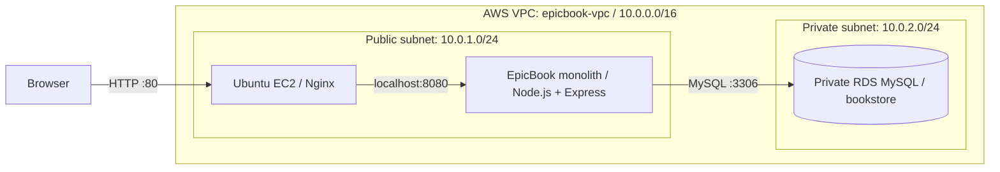
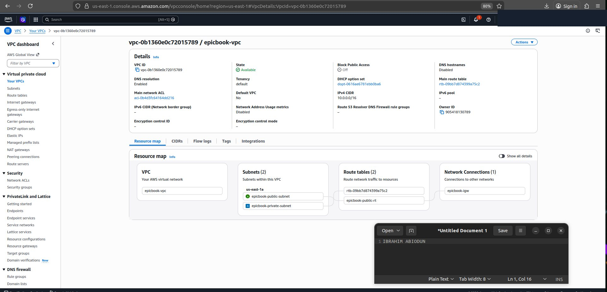
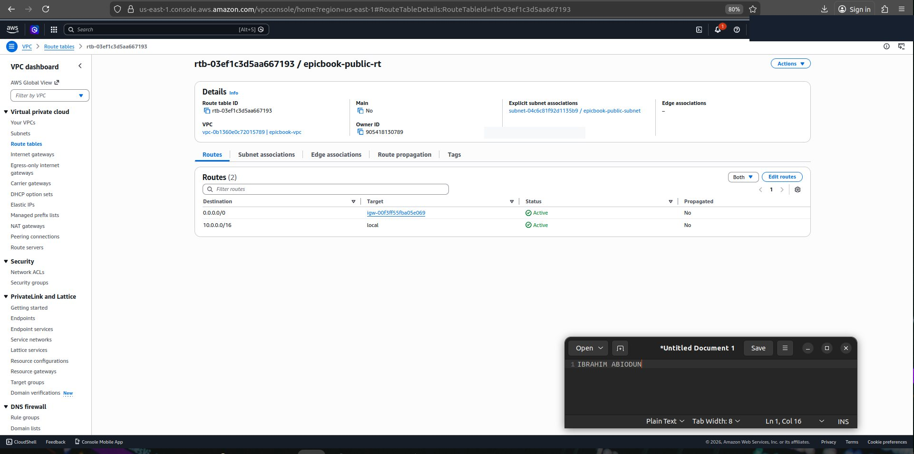
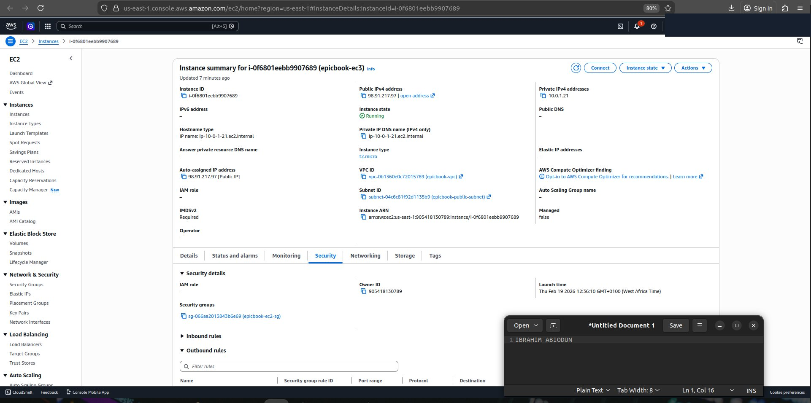
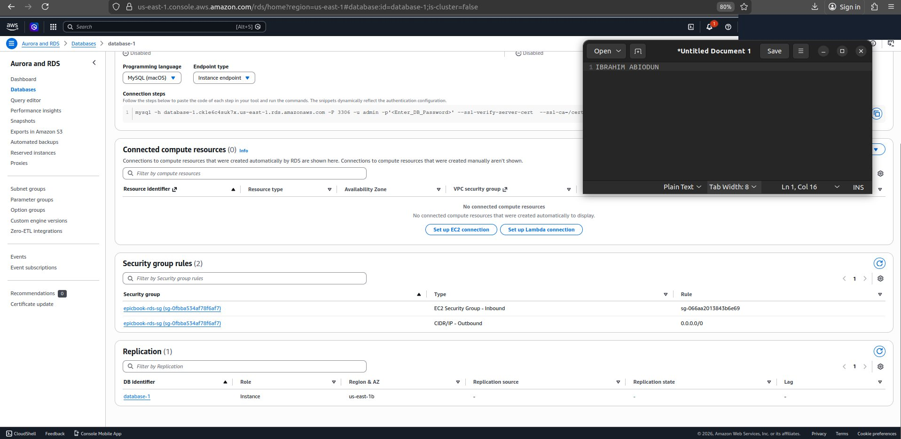
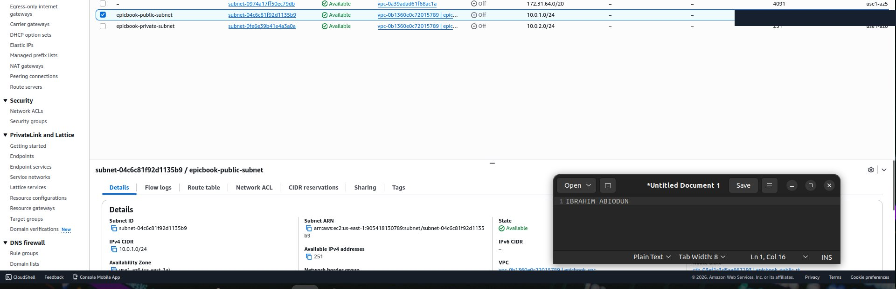
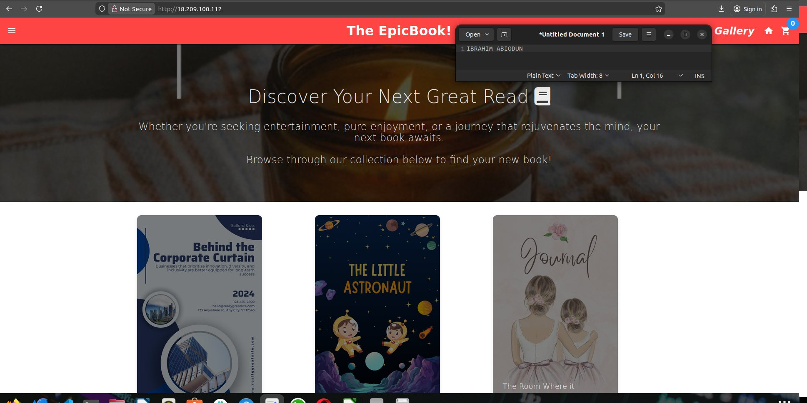

# EpicBook — Monolithic Application on AWS

**Two-tier AWS deployment · EC2 + Nginx + Node.js/Express + private RDS MySQL**  
**DevOps Micro Internship (DMI), Cohort 2 · Week 6, Assignment 2**

## Overview

Deployed the **EpicBook** monolithic web application on an Ubuntu **Amazon EC2** instance and connected it to **Amazon RDS MySQL** in a private subnet. **Nginx** served as a reverse proxy to the Node.js/Express application. The app's routes, server-rendered views, and API run together as one deployable application; the database is a separate infrastructure tier.

> **Project scope:** This repository documents the EpicBook work on **pages 11–33** of my Week 6 report. It does **not** claim ALB, Auto Scaling, WordPress, PHP hit-counter, or Multi-AZ failover for EpicBook. Those activities belong to the separate high-availability assignment.

## Architecture

[Editable architecture diagram](diagrams/architecture.mmd)

## Implementation

1. **Networking:** Built the `epicbook-vpc` (`10.0.0.0/16`), public/private subnets, Internet Gateway, route tables, and security groups. Restricted RDS MySQL port `3306` to the EC2 security group.
2. **Compute:** Provisioned an Ubuntu EC2 VM and installed Git, Node.js, npm, Nginx, and MySQL client.
3. **Application:** Cloned the supplied EpicBook repository, installed dependencies, configured MySQL access, and ran the Express server on **port 8080**.
4. **Database:** Created non-public RDS MySQL, imported `author_seed.sql` before `books_seed.sql`, and verified the `bookstore` database and application connectivity.
5. **Reverse proxy:** Configured Nginx to forward HTTP requests on **port 80** to Node.js on `localhost:8080`; EpicBook uses dynamic views rather than a standalone `public/index.html`.
6. **Verification:** Loaded EpicBook in a browser and tested the `/api/cart` endpoint locally and through the Nginx proxy.

## Troubleshooting

| Challenge | Resolution |
| --- | --- |
| EC2 SSH/internet and DNS problems | Corrected subnet selection, public IP, routes, NACL/resolver configuration, and SSH-key permissions. |
| SQL schema file was empty | Inspected seed scripts; imported authors before books. |
| Nginx `403 Forbidden` | Switched from an incorrect static `index.html` configuration to the Node.js reverse proxy. |
| Endpoint unavailable externally | Checked port 80 security-group rules and Nginx listener. |
| API request used an incorrect route | Verified `/api/cart` through the correct proxy path. |

See [deployment guide](docs/DEPLOYMENT.md) and [troubleshooting guide](docs/TROUBLESHOOTING.md).

## Screenshots — original Week 6 evidence

These screenshots were extracted from **Assignment 2, pages 11–33** and document the original exercise. They are not current live AWS status.

| VPC setup | Public subnet routing |
|:--:|:--:|
|  |  |

| EC2 instance | Private RDS MySQL |
|:--:|:--:|
|  |  |

| VPC subnet configuration | Application homepage |
|:--:|:--:|
|  |  |

[Full screenshot provenance](screenshots/EVIDENCE_SOURCES.md)

## Repository content and attribution

The original EpicBook application has `server.js`, `routes/`, `views/`, `models/`, `public/` and `db/`. My work focused on AWS setup, application deployment, reverse-proxy configuration, database integration, and troubleshooting.

**Original application:** [pravinmishraaws/theepicbook](https://github.com/pravinmishraaws/theepicbook). The source application was supplied for training; this portfolio documents my deployment work rather than claiming original application authorship.

**Security:** Do not commit `.env`, real `config/config.json` credentials, SSH private keys, database passwords, or unreviewed screenshots. See [security notes](docs/SECURITY.md).

**GitHub repository:** [slim274/aws-epicbook-monolithic-app](https://github.com/slim274/aws-epicbook-monolithic-app) (URL becomes valid after renaming the existing repository).
