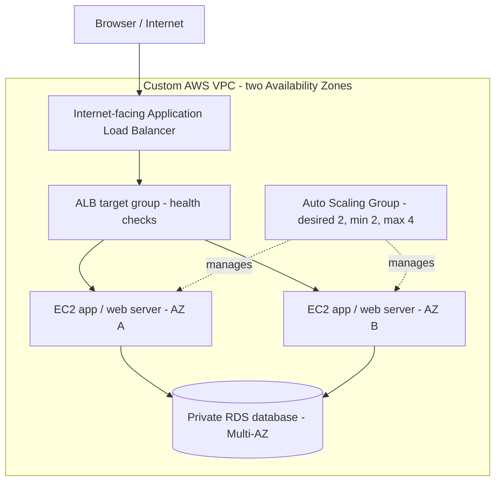

# Highly Available Two-Tier AWS Application | ALB, Auto Scaling & RDS

**AWS cloud infrastructure · VPC networking · High availability · Linux operations · Incident testing**

A documented **two-tier AWS lab** completed during **DevOps Micro Internship (DMI), Cohort 2 — Week 6** (submission: **27 February 2026**). I configured a multi-AZ network, load-balanced web/application instances, and a private Multi-AZ relational database. I tested a small PHP/MySQL hit-counter application and performed application availability checks.

> **Scope:** This repository documents an instructor-led, hands-on AWS exercise (Week 6, Assignment 3). It is **not** a continuously running production service, a Terraform implementation, or evidence of end-to-end automated bootstrap across every instance. The later WordPress variation of this lab is documented separately in `aws-wordpress-alb-rds`.

## What I worked on

- Built an AWS VPC (`10.0.0.0/16`) with **two public and two private subnets** distributed across two Availability Zones.
- Configured an Internet Gateway, NAT Gateway, public/private route tables, and security-group references between the ALB, EC2, and RDS tiers.
- Provisioned a **non-public, Multi-AZ RDS database** within private subnets.
- Created an Ubuntu 24.04 EC2 launch template (`t3.micro`) with user-data steps for Apache2, PHP and MySQL connectivity.
- Validated a PHP hit counter that writes to its relational database.
- Configured an **internet-facing Application Load Balancer**, HTTP target-group health checks, and an **Auto Scaling Group** with desired/min/max capacity **2/2/4**.
- Checked load-balancer reachability, target health, and instance-replacement behavior; diagnosed issues with HTTP rules and unhealthy targets.

## Architecture

This is a **logical design** from the submitted assignment, not a claim that every instance was proven to be in the same subnet throughout the lab. The report describes both public-subnet and private-subnet placement for ASG instances in different sections.



**Tiers:** (1) PHP/Apache application tier behind an ALB; (2) private RDS database tier. The ALB is the entry point, rather than a separate application tier.

## AWS components

| Component | Documented role |
| --- | --- |
| VPC / 4 subnets | Network segmentation across two AZs |
| Internet Gateway / NAT | Public inbound routing and private outbound routing |
| ALB `ha-web-alb` | HTTP entry point and target-group health checks |
| EC2 + Apache2/PHP | Dynamic hit-counter application |
| Auto Scaling Group `ha-web-asg` | Maintain desired capacity; configured at 2/2/4 |
| RDS Multi-AZ | Non-public relational database for the application |
| Security groups | HTTP from ALB to web tier; database port only from EC2 SG |

## Implementation record

### 1. Network and database configuration

I created the VPC/subnets, public and private routes, and separate security groups: `ha-alb-sg`, `ha-web-sg`, and `ha-db-sg`. The database subnet group used private subnets in separate AZs, and **public access was disabled**.


### 2. Application configuration and validation

The EC2 launch-template user data attempted to install Ubuntu Apache/PHP packages and deploy `index.php`. The lab's hit counter used MySQL connectivity and returned a browser-visible view count. **Some first-boot setup required manual correction**, including replacing an Amazon Linux `httpd` command with Ubuntu `apache2` and removing the Apache default `index.html`.

Checks I used during the exercise included:

```bash
sudo systemctl status apache2
curl http://localhost
sudo ss -tulpn
sudo tail -n 50 /var/log/apache2/error.log
sudo tail -n 50 /var/log/cloud-init-output.log
```


### 3. Load balancing and scaling

I created the public ALB, registered targets on **HTTP port 80**, tested the `/` health-check path, and attached an Auto Scaling Group. I corrected target-health problems by allowing HTTP traffic **from the ALB security group to the EC2 security group**, rather than opening the backend indiscriminately.


### 4. Availability testing and troubleshooting

The assignment documents checking ALB availability while detaching an instance with **replacement enabled**, and observing the target group's draining/health behavior. This is a **controlled instance-replacement exercise**, not proof that an entire Availability Zone physically failed.


The detailed troubleshooting notes are in [docs/operations-and-recovery.md](docs/operations-and-recovery.md).

## Results and limitations

- Verified the PHP hit-counter page could be reached and interact with an RDS database.
- Configured the ALB and ASG across two AZs, and performed manual availability checks.
- Resolved errors involving package names, default Apache content, first-boot configuration, ports and unhealthy targets.
- **Limitations:** The report describes manual bootstrap fixes and does not consistently identify ASG instance subnet placement; it does not establish automated recovery across every failure scenario, HTTPS, or production hardening.

**Evidence:** Screenshots were selected from the submitted Week 6 report (pages 36–57). Browser URLs and AWS resource states are historical. Browser/account banners were obscured in the exported screenshots; review all files again before publishing.

## Skills demonstrated

`AWS EC2` · `VPC` · `Subnets` · `Security Groups` · `NAT Gateway` · `ALB` · `Auto Scaling` · `RDS Multi-AZ` · `Apache` · `PHP` · `Linux` · `Cloud Troubleshooting` · `Availability Testing`

## Author

**Ibrahim Ahmed Abiodun**  
GitHub: [@slim274](https://github.com/slim274)  
**Training:** DevOps Micro Internship — Cohort 2, Week 6, Assignment 3